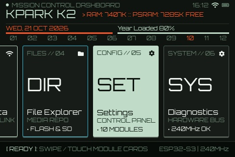
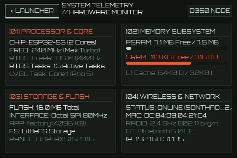
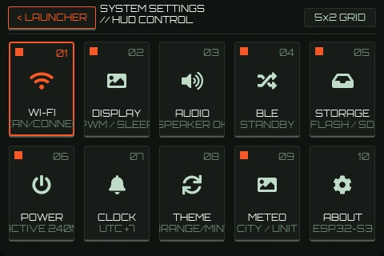
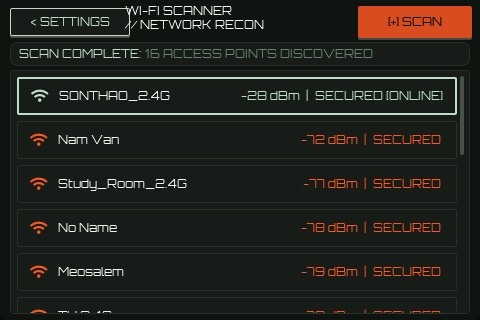
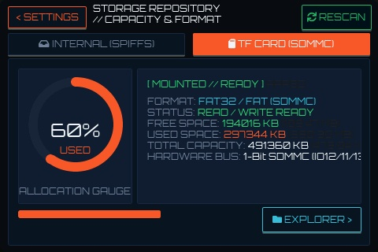
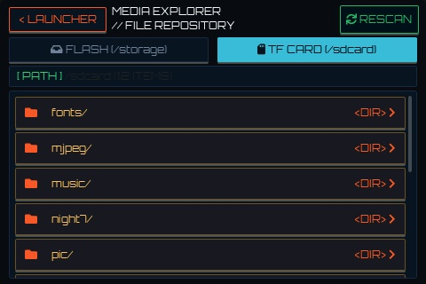
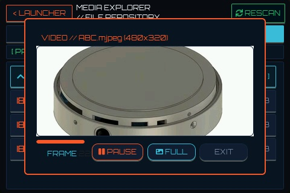
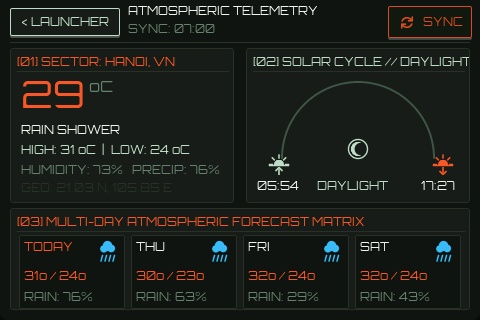
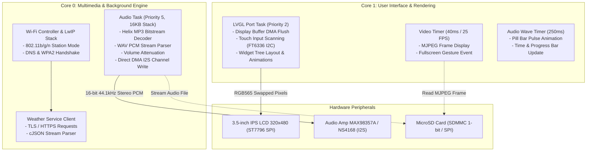

# JC3248W535EN CyberDeck // Smart IoT Display Terminal

[](https://platformio.org/)
[](https://www.espressif.com/)
[](https://lvgl.io/)
[](LICENSE)

An advanced Cyberpunk / Orbital-HUD styled IoT OS and Multimedia Terminal built for the **JC3248W535EN** (ESP32-S3 3.5-inch 320x480 Capacitive Touch IPS display module with 8MB Octal PSRAM, 16MB Flash, MicroSD card slot, and onboard I2S audio amplifier).


---

## 🌟 Acknowledgement & Credits

This project was originally forked from the foundational work by **[NorthernMan54/JC3248W535EN](https://github.com/NorthernMan54/JC3248W535EN)**. Special thanks and appreciation to **NorthernMan54** for pioneering the PlatformIO + ESP-IDF build configuration and board support package for this hardware.

---

## 📸 Live Screen Captures & UI Gallery

All screenshots below are native 1:1 pixel captures (480x320) taken directly on the physical hardware using the onboard screenshot utility:

| Mission Control Dashboard | System Telemetry & Diagnostics |
| :---: | :---: |
| <br/>*Orbital HUD Desktop with live RAM/PSRAM stats & module cards* | <br/>*ESP32-S3 Dual-Core stats, task counter, SRAM/PSRAM gauges & storage* |
| **System Settings Grid (5x2 HUD)** | **Wi-Fi Scanner & Network Recon** |
| <br/>*Modular 5x2 settings control panel with 10 dedicated sub-modules* | <br/>*Live 2.4GHz AP scan, RSSI signal indicators & active connection status* |
| **Storage Diagnostics & Capacity** | **Media File Explorer** |
| <br/>*Radial storage allocation gauge, FAT32 mount status & 1-bit SDMMC bus* | <br/>*Dual-drive file repository with folder navigation across Flash & TF Card* |
| **Motion JPEG Video Player** | **Atmospheric Telemetry (Weather HUD)** |
| <br/>*Real-time ~25 FPS MJPEG stream player with Fullscreen toggle mode* | <br/>*Open-Meteo REST API weather, Solar cycle daylight arc & 4-day forecast* |

---

## 🚀 Completed Features

### 1. Sci-Fi Cyberpunk HUD Interface & Design System
* **Aesthetics**: Orbital HUD / CyberDeck styling with custom typography (`Orbitron` & `Montserrat`), glowing neon accents (`#38bfd8` Cyan, `#00e5ff` Electric Blue, `#00e676` Mint, `#ff9100` Orange).
* **Interactive Boot Screen**: Cyberpunk terminal hardware self-test diagnostic log with animated progress bar and hold delay before launching the desktop.
* **Main Launcher**: Hexagonal status dashboard featuring a real-time digital clock, Wi-Fi status indicator, live weather summary badge, customizable Mission Name badge, and 4 interactive application launchers.

### 2. File Explorer & Multimedia Station (Launcher 04)
* **Dual Storage Browser**: Real-time browsing and recursive directory traversal across Internal Flash (`/storage`) and MicroSD Card (`/sdcard`) with dynamic path breadcrumbs.
* **Real I2S Music Player**:
  * Decodes **MP3** via embedded **Helix MP3 Decoder** (supports up to 320kbps, dynamic sample rate detection) and **WAV** (RIFF PCM 8/16-bit).
  * Streams audio directly to the onboard MAX98357A / NS4168 amplifier over I2S standard Philips mode.
  * **Sound Waveform Visualizer**: Modern voice-message style waveform consisting of 32 vertical pill bars with rounded caps, dynamic height pulse animation during playback, and real-time played/unplayed color highlighting.
  * Real-time track duration counter, Play/Pause/Stop controls, and volume attenuation.
* **Real Image Viewer**:
  * High-performance hardware/software integer decoding for **JPEG** (`.jpg`, `.jpeg` via **JPEGDEC**) and uncompressed **BMP** (`.bmp`).
  * Decoded directly into PSRAM with exact **RGB565 Big-Endian (`LV_COLOR_16_SWAP 1`)** byte order for 100% color accuracy (eliminating inverted or garish tints).
  * **Fullscreen Mode**: Tap anywhere on the picture or click the `[ ] FULL` button to expand to 480x320 fullscreen; tap again to shrink back to the modal popup.
* **Real Motion-JPEG Video Player**:
  * Real-time streaming playback of Motion JPEG (`.mjp`, `.mjpeg`) video streams at ~25 FPS driven by LVGL timers.
  * Play / Pause toggle, progress bar timeline, and live frame counter.
  * **Fullscreen Mode**: Tap anywhere on the video or click `[ ] FULL` to watch in fullscreen; tap again to restore player controls.
* **Terminal Text Viewer**: 80% screen phosphor-green terminal modal for inspecting `.txt`, `.log`, `.json`, `.c`, `.h`, `.ini`, and `.md` files, with automatic binary/corrupted character protection.

### 3. Settings Application
* **Display Settings**: Live screen brightness slider with real-time PWM control, Display Sleep timeout toggle with preset durations (10m, 30m, 1h, 2h).
* **Storage Diagnostics**: Dual storage capacity visualization with circular Gauge / Donut chart, filesystem status, and detailed free/total KB metrics.
* **About Screen**: Hardware specifications summary, interactive on-screen virtual keyboard to rename the device **Mission Name** (saved and synced across the desktop).

### 4. Weather & Environmental Application
* Real-time weather data fetching over Wi-Fi via the Open-Meteo REST API (temperature, humidity, weather condition code, wind speed).
* 5-day weather forecast cards with custom vector weather icons.

### 5. System Diagnostics
* Live Free RAM (Internal SRAM) & Free PSRAM monitors.
* Task manager breakdown, CPU frequency display, and uptime tracker.

### 6. Hardware Screen Capture / Screenshot Utility
* **Pixel-Perfect 1:1 Capture**: Leverages `lv_snapshot_take_to_buf()` in PSRAM and exports to standard 24-bit TrueColor uncompressed BMP (`480x320`, 460KB).
* **Automatic Storage Routing & Fallback**: Automatically saves directly to MicroSD Card (`/sdcard/snapXXXX.bmp`), gracefully falling back to internal flash (`/storage/snapXXXX.bmp`) if no SD card is mounted or writable.
* **Dual Triggering Methods**:
  * **Touch Gesture**: Press and hold the **top-right corner** of the screen for 1.5 seconds on any screen.
  * **Serial Console Command**: Type `screenshot` or `cap` in the serial terminal (`pio device monitor`).
* **Visual Feedback**: Plays a camera shutter white flash animation and displays a toast banner confirming the saved file path.

---

## 🧠 System Architecture & Dual-Core Multitasking

The ESP32-S3 contains two Xtensa 32-bit LX7 cores running at 240MHz. To guarantee zero audio stuttering and rock-solid 60 FPS touch responsiveness, tasks are strictly pinned to dedicated CPU cores:



### Inter-Core Communication & Memory Isolation
* **Non-Blocking UI**: The audio playback task runs at `Priority 5` on **Core 0**, using FreeRTOS atomic state flags and non-blocking delays (`vTaskDelay(1)`). Core 1 is never stalled by SD card reads or MP3 decoding.
* **PSRAM Isolation**: Large framebuffers (such as `s_media_rgb_buf` sized `480 × 320 × 2` bytes = ~300 KB) and MP3 decoder work areas are allocated strictly in **8MB Octal PSRAM** (`MALLOC_CAP_SPIRAM`), leaving internal SRAM (`320KB`) 100% free for DMA descriptors and interrupt service routines.
* **Stack Overflow Prevention**: Large decoder structures (such as `JPEGDEC`, which exceeds 20 KB) are allocated dynamically from PSRAM heap rather than on the local task stack.

---

## 🔊 I2S Audio Hardware Specification

The onboard speaker is driven by a class-D audio amplifier (MAX98357A / NS4168) fed by the ESP32-S3 hardware I2S controller (`I2S_NUM_0`).

| I2S Signal | ESP32-S3 GPIO | Description |
| :--- | :--- | :--- |
| **BCK** (Bit Clock) | `GPIO 42` | Audio bit clock (BCLK) |
| **LRCK / WS** (Word Select) | `GPIO 2` | Left/Right channel select (LRCK) |
| **DOUT / DIN** | `GPIO 41` | Serial audio data stream into amplifier |
| **MCLK** | `-1` | Not required (internal PLL master clock) |

* **Protocol**: I2S Standard Philips mode (Master Transmitter).
* **Sample Rates**: Dynamic automatic switching from `8000 Hz` up to `48000 Hz` (default `44100 Hz`).
* **Bit Depth**: 16-bit signed PCM, Stereo.
* **Safe Clock Reconfiguration**: Follows the ESP-IDF 5.x specification (`i2s_channel_disable` $\rightarrow$ `i2s_channel_reconfig_std_clock` $\rightarrow$ `i2s_channel_enable`).

---

## 🎨 Display & Color Configuration (`LV_COLOR_16_SWAP`)

The 3.5" IPS panel uses the **ST7796** controller configured for byte-oriented SPI transmission.
* In `lv_conf.h`, `#define LV_COLOR_16_SWAP 1` is enabled.
* Consequently, all RGB565 true-color image buffers (`LV_IMG_CF_TRUE_COLOR`) require big-endian byte ordering.
* To achieve vibrant and natural color reproduction:
  * **JPEGDEC** is initialized with `jpeg->setPixelType(RGB565_BIG_ENDIAN);`.
  * **BMP** decoders swap 16-bit word bytes with `__builtin_bswap16()`.

---

## 🗺️ Roadmap & Upcoming Features

### ⚙️ Settings Module Expansion:
- [ ] **BLE Manager**: Bluetooth Low Energy device scanner and pairing interface.
- [ ] **Screen Saver**: Sci-Fi Matrix rain, CRT phosphor burn-in protection, and ambient starfield animation modes.
- [ ] **Clock & Alarms**: NTP network time server synchronization, timezones, and programmable buzzer/chime alarms.
- [ ] **Power Management**: Battery ADC voltage telemetry, auto-sleep idle timer, and ESP32-S3 Light/Deep Sleep modes.

### 📱 New Applications:
- [ ] **Home Assistant Dashboard**: Direct integration with Home Assistant via WebSockets / REST API to monitor smart home sensors and toggle relays/switches.
- [ ] **Virtual Keyboard & Macro Pad for PC**: BLE HID keyboard & trackpad with customizable shortcut keys.
- [ ] **Habits Tracking**: Daily habit tracker with streak counters, completion checkmarks, and visual progress charts.
- [ ] **Notes & Memos**: Touch notepad with full on-screen QWERTY virtual keyboard and persistent storage.
- [ ] **Pomodoro Timer**: Productivity focus timer with audio cues and pause intervals.

---

## 🛠️ How to Build and Flash

### Prerequisites
* [PlatformIO IDE](https://platformio.org/) installed in VS Code.
* USB-C data cable connected to the USB/UART port of the JC3248W535EN board.

### Build & Upload Firmware:
```powershell
# Build firmware
pio run

# Flash to device
pio run --target upload

# Monitor serial debug logs
pio device monitor
```

---

## 📄 License
This project is open-source under the [MIT License](LICENSE).
Original board BSP configuration by [NorthernMan54](https://github.com/NorthernMan54/JC3248W535EN).
Cyberpunk HUD UI, FreeRTOS multitasking architecture, I2S audio player, and media decoders developed for the community.